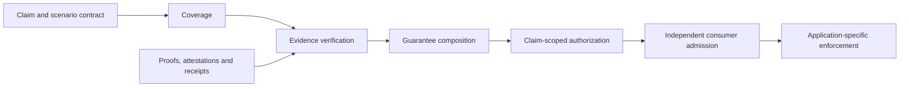

# Verifiable Execution & Claim Authorization

Experimental research and executable verification tools for determining **which
downstream claims a collection of proofs, attestations and execution records can
actually authorize**.

A valid inference proof, authentic judgment and valid receipt can refer to different
inputs, subjects, actions or policies. This project makes those relationships explicit,
checks the evidence for each required relationship, and recomputes authorization at
the consumer boundary.

> **Research status: PARTIAL_CHAIN_VERIFIED.** The integration and escrow experiments
> are reproducible laboratory studies. A complete external provenance-to-execution
> chain has not been established. **Production payments: HOLD.**

Initiated by [Pavlo / pipavlo82](https://github.com/pipavlo82) as
`verifiable-ai-guarantee-composition`, the project now lives under
[Trustless AI](https://github.com/trustless-ai), preserving its history, contributors,
pull requests and evidence. Research policies here are separate from normative ERC
requirements; this repository is not a security certification.

## Project structure

| Component | Purpose and current state |
| --- | --- |
| Research model | Typed guarantees, dependencies, authorities, scenario contracts, counterexamples and prior-art analysis |
| Claim-Aware Verification Engine | Experimental composition, claim-scoped authorization and independently recomputed consumer admission |
| Agent Conformance Harness | Existing vectors, replay runners and mutation controls; a general adapter interface for arbitrary implementations is a next development stage |
| Application adapters | External ERC-8404 consumer and verdict-gated escrow laboratory experiment |

The conformance harness is a component of the broader research programme. Escrow is
one downstream use case, not the definition of the project.



**Coverage** identifies obligations from an independently supplied scenario contract.
**Verification** checks whether evidence establishes each obligation. **Composition**
determines whether those guarantees jointly authorize the requested claim. Contract
adequacy remains an external assumption: a list of implemented checks does not prove
that every necessary requirement was declared.

Decisions retain `VERIFIED`, `REFUTED` and `UNVERIFIABLE`. Missing evidence refuses
authorization without becoming a refutation. Authorized results identify the scenario,
claim type, recomputed contract digest and verified scope. Admission does not trust a
mutable `authorized=true` flag. Checker independence (O14) applies only when required
by policy; different keys do not prove different real-world controllers.

Read the [engine contract](research/integration/CLAIM_AWARE_ENGINE.md),
[coverage model](research/v4/FORMAL_MODEL.md),
[obligation catalog](research/v4/OBLIGATION_CATALOG.md) and
[trust boundaries](research/integration/TRUST_BOUNDARIES.md).

## Current integrated state

As of **2026-10-21**, research PRs **#2-#8 are merged into `main`**. The combined
research baseline is
[`3d55a8456dddb3cb981c91b143761e87e31d7531`](https://github.com/trustless-ai/verifiable-execution-claim-authorization/commit/3d55a8456dddb3cb981c91b143761e87e31d7531).
[PR #7](https://github.com/trustless-ai/verifiable-execution-claim-authorization/pull/7)
and [PR #8](https://github.com/trustless-ai/verifiable-execution-claim-authorization/pull/8)
retain the integration and escrow implementation history. See
[GitHub Actions](https://github.com/trustless-ai/verifiable-execution-claim-authorization/actions)
for commit-specific CI outcomes.

Historical reports describe their own dates, commits and publication constraints.
References there to drafts, unmerged dependencies or prohibited publication are
historical, not current repository status. Original results and failed runs remain
preserved. Merging research does not establish independent academic approval or
production readiness.

## Reproduced experimental results

These are **two separate finite experiments** with different baselines and
denominators. Counts do not estimate deployment exploit rates or universal coverage.

| Experiment | Scenarios | Applied mutations | Unsupported downstream authorizations |
| --- | --- | --- | --- |
| Claim-aware integration | 61: 2 positives, 59 negative/unsupported | 22 KILLED / 0 SURVIVED / 0 CRASHED | Component-only: 51/59; declared checks: 13/59; scenario-complete composition: 0/59; independently recomputed admission: 0/59 |
| Verdict-gated escrow | 31/31 expected: 1 positive, 28 authorization-negative, 2 token-execution controls | 22 KILLED / 0 SURVIVED / 0 CRASHED; 6 absent on-chain guards separately NOT_APPLIED | Signed verdict only: 24/28; claim-aware issuance: 2/28; issuance plus existing on-chain enforcement: 2/28 |

The two remaining escrow cases concern **expiration and revocation after signing**.
An earlier admission is not perpetual execution-time authorization. These are not
surviving mutants. Missing broader research-policy checks are not automatically
violations of the upstream contract's documented, narrower guarantees.

Replay suites cover normal/repeated/Python `-O` runs, native proof verification,
cryptographic cross-checks, source-copy mutations and deterministic semantic outputs.
Crashes are not kills; repeated regression runs do not create additional mutations.

- **Integration:** [results](research/integration/EXPERIMENT_RESULTS.md),
  [mutations](research/integration/MUTATION_REPORT.md),
  [machine-readable evidence](evidence/integration/validation/report.json).
- **Escrow:** [technical report](research/escrow-v0/REPORT.md),
  [results and gas-measurement scope](research/escrow-v0/EXPERIMENT_RESULTS.md),
  [mutations](research/escrow-v0/MUTATION_REPORT.md), [evidence](evidence/escrow-v0/).
- **ERC-8404:** [compatibility](research/erc8404/COMPATIBILITY_MATRIX.md),
  [external profile](research/erc8404/CLAIM_AWARE_PROFILE.md),
  [frozen Core baseline](research/erc8404/CORE_BASELINE.md).

ERC-8404 Core, original conformance vectors and upstream escrow implementation remain
unchanged. Additional authorization rules live in external research consumers.

## Reproduce

Clone the complete Git history: integrity checks need pinned ancestor commits.
Run commands from the repository root. The pinned replay environment uses Python
**3.12**.

### Lightweight synthetic baseline

```sh
git clone https://github.com/trustless-ai/verifiable-execution-claim-authorization.git
cd verifiable-execution-claim-authorization
python -B tools/verify_artifacts.py
python -B tools/validate.py
```

This standard-library entry point runs the **v0 synthetic baseline**, including
normal/repeat/optimized tests and mutations. It does not establish cryptographic or
full-chain verification. Results go to `build/validation/`.

### Real-artifact integration

Install Node **22.15.0**, Bun **1.3.14** and Rust **1.97.1**, then run:

```sh
rustup override set 1.97.1
python -B tools/v3/prepare.py --online
python -B tools/integration/validate.py
python -B tools/verify_artifacts.py
```

Preparation fetches pinned dependencies and builds the native verifier; it does not
generate replacement evidence. Commands, exit codes and replay logs go to
`build/integration/validation/`. See the
[review checklist](research/integration/INDEPENDENT_REVIEW_CHECKLIST.md) and
[source lock](fixtures/integration/source-lock.json).

### Local escrow

After integration preparation, install Foundry **1.7.1**; the harness uses solc
**0.8.26**. In a fresh checkout, reproduce the locked forge-std bytes as the
[CI workflow](.github/workflows/verdict-escrow.yml) does:

```sh
git -c core.autocrlf=true clone --no-checkout https://github.com/foundry-rs/forge-std.git build/escrow/forge-std-source
git -C build/escrow/forge-std-source -c core.autocrlf=true checkout --detach b013eff2ac4fce26f34d789e6f5c49021c5ee817
python -B tools/escrow_prepare.py --forge-std-cache build/escrow/forge-std-source
python -B -X utf8 tools/escrow_ci.py
python -B tools/verify_artifacts.py
```

The dependency checkout setting reproduces its locked representation; repository
technical text uses LF. This suite executes local EVM/mock-token tests, authorization
mutations, integrity controls and semantic determinism checks. It does not broadcast
transactions or require production keys or real funds. Logs go to `build/escrow/ci/`.

Do not regenerate manifests to hide unexplained mismatches. The old root README is
retained byte-for-byte in [this historical snapshot](research/history/README-3d55a845.md)
(its relative links refer to the original root location). The baseline checker permits
only the explicitly pinned current README version and still requires the archived
original and complete current inventory.

## Evidence boundaries and next work

The demonstrated chain is **LABORATORY_VERIFIED / PARTIAL_CHAIN_VERIFIED**; the escrow
adapter is **PARTIALLY_COMPATIBLE** with the existing contract.

- Native zkIE verification establishes its pinned statement, not original input
  admission, model authorization or arbitrary task completion.
- Authentic signatures identify signers, not factual judgment correctness or
  independent real-world controllers.
- Coverage assumes adequate scenario contracts and authority policies.
- A receipt or matching digest does not independently establish external execution,
  admission of original bytes or successful real-world payment.
- Escrow does not make the external adapter mandatory or enforce the required
  expiration/revocation policy at execution time. Production signing-service
  compatibility and authenticated payer/state inputs remain unestablished.

Next work is to extract a reusable harness interface, reproduce it against another
independent implementation, and obtain the missing external bindings. Scientific
novelty and end-to-end external success are not claimed. Read the
[integration limitations](research/integration/LIMITATIONS.md),
[escrow limitations](research/escrow-v0/LIMITATIONS.md) and
[open proof obligations](research/OPEN_PROOF_OBLIGATIONS.md).

## Research history and contribution

| Stage | Preserved contribution |
| --- | --- |
| [v0-v1](research/PAPER_OUTLINE.md) | Synthetic composition and typed obligations. V0 was explicitly reconstructed because the original ZIP was unavailable; that missing archive was never verified. |
| [v2](research/V2_REAL_ARTIFACT_REPORT.md) | Laboratory signatures and native proof artifacts. Original mutations: 18 KILLED / 2 SURVIVED; the [separate audit](research/V2_SURVIVOR_AUDIT.md) reports 2 isolated kills without rewriting history. |
| [v3](research/V3_REAL_CHAIN_REPORT.md) | Published artifacts, dependencies and explicit missing real-chain links. |
| [v4](research/v4/RESULTS.md) | Scenario-relative coverage independent of the verifier's own check inventory. |
| [v4.1](research/v4_1/README.md) | Scenario-dependent O14 and authorization-scope binding. |
| [ERC-8404 consumer](research/erc8404/EXPERIMENT_RESULTS.md) | External profile. Original 16/1 mutation report and later [fallback isolation](research/integration/MUTATION_REPORT.md) remain distinct. |
| [Integration](research/integration/EXPERIMENT_RESULTS.md) | Combined guarantees and independently recomputed admission. |
| [Escrow](research/escrow-v0/REPORT.md) | Signed-verdict consumption and local enforcement under explicit limits. |

For academic context, read the [paper draft](research/ACADEMIC_PAPER_DRAFT.md),
[integration addendum](research/integration/ACADEMIC_PAPER_DRAFT.md) and
[prior-art analysis](research/PRIOR_ART_ANALYSIS.md). Candidate propositions and
observations are not presented as proven general theorems.

Independent review and adapters are welcome. Reports should identify exact commits,
scenario contracts, expected scope, commands and raw outcomes. Separate normative
requirements from research policies; preserve negative witnesses and historical evidence.

Original project code is [MIT licensed](LICENSE). Vendored material and fetched
dependencies retain their upstream licenses and attribution.
