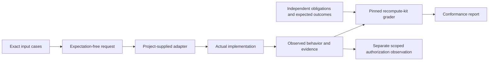

# Agent Conformance Harness: first reusable pilot

This is an experimental adapter profile, transport boundary and evidence report for the existing recompute-kit grader. It is part of **Verifiable Execution & Claim Authorization**. It does not introduce another verification engine.

The first backend executes the preserved ERC-8404 RVR v0 Python reference verifier and this repository's existing external claim-aware consumer. It verifies real byte commitments and laboratory EIP-712 signatures. It does not execute escrow logic, verify native inference, or authorize payments.



Run from the repository root with Python 3.12 and Node 22.15.0:

Use a **full Git clone**. Historical integrity verification reads
`2e329fffbee103047d034b97056aea9e49cf1c58:artifacts.sha256.json`; a depth-one
checkout of the PR head does not contain that object. In an existing shallow
clone, fetch the required base explicitly before running validation:

```sh
git fetch origin 2e329fffbee103047d034b97056aea9e49cf1c58
```

GitHub Actions already uses `fetch-depth: 0`. Missing history is a reproduction
prerequisite failure, not a backend-conformance failure.

```sh
python -B tools/agent_harness.py prepare
python -B research/formal-v1/prepare_crypto.py
npm ci --ignore-scripts --no-audit --no-fund --prefix build/formal-v1/crypto
python -B tools/agent_harness.py run
python -B tools/harness_v0/validate.py
python -B tools/verify_artifacts.py
```

`prepare` downloads three exact pinned recompute-kit files into ignored `build/`. Alternatively, `prepare --source /path/to/recompute-kit` uses local bytes and checks the same hashes. Subsequent execution is offline. No production credentials, chain RPC, deployment or funds are involved.

The CLI returns **0** only for a completed matching suite, **1** for a witnessed behavior mismatch, and **2** when the suite cannot be established. A conformant refusal is a PASS for conformance and remains REFUTED or UNVERIFIABLE for authorization. Reports are observations of a trusted local execution, not transferable authorization credentials.

- [Adapter contract and developer guide](PROTOCOL.md)
- [Architecture and reuse audit](../../research/harness-v0/ARCHITECTURE_AND_REUSE.md)
- [Source-pinned coverage](../../research/harness-v0/COVERAGE.md)
- [Results and physical mutations](../../research/harness-v0/RESULTS.md)
- [Limitations and review checklist](../../research/harness-v0/LIMITATIONS.md)
- [Supplemental reviewer controls and reproduction](../agent-harness-review-v0/README.md)
- [Exact source lock](source-lock.json)
- [Independent obligations](erc8404/obligations.json)
- [Preserved evidence](../../evidence/harness-v0/)

Status: **IMPLEMENTED** transport/profile/CLI; **EXPERIMENTALLY VERIFIED** finite laboratory pilot; **PARTIALLY VERIFIED** broader real chain; **NOT_COVERED** other ERC implementations and an independently authored second backend; **UNSUPPORTED** arbitrary execution authorization.
