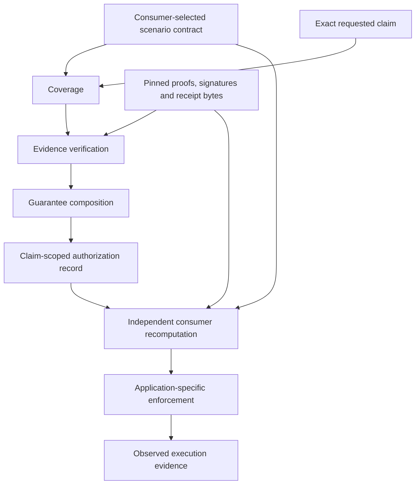

# Architecture

This document describes existing research behavior and the proposed reusable
architecture separately. See [status](STATUS.md) for versions and
[roadmap](../ROADMAP.md) for acceptance gates.

## Three verification layers and consumer admission

The arrows identify required bindings, not proof that every link is established.
In particular, application enforcement and external execution remain separate
obligations. The observed execution in the escrow experiment is local EVM/mock-token
behavior; the full external chain is not verified.

| Boundary | Existing behavior | Remaining assumption or limit |
| --- | --- | --- |
| Coverage | Required obligations are compared with a separately supplied scenario contract and the supported claim's minimum requirements. | Scenario adequacy is externally assumed; the engine does not discover every possible missing requirement. |
| Verification | Pinned native proof verification, signature recovery, receipt checks and evidence commitments are executed. | A valid proof/signature establishes its own statement/authenticity, not arbitrary truth or authority. |
| Composition | Exact claim fields, profile/contract digests, dependencies and scope are checked. | Separate subject labels are not silently asserted to denote the same entity. |
| O14 | Distinct recovered keys are required only under applicable scenario policy. | Key distinction does not establish controller independence. Missing/incomparable identity evidence cannot silently pass. |
| Authorization | A decision records the exact scope supported by the selected contract and evidence. | It is not a bearer credential or permission for arbitrary actions. |
| Admission | The consumer re-evaluates evidence and compares the presented record with the fresh result. | Local verifier, runtime and filesystem integrity are trusted during the call. |
| Enforcement | An external adapter issues a laboratory signed verdict; unchanged escrow checks its own narrower release conditions. | The contract does not make this adapter mandatory or independently enforce every off-chain field/policy. |

## Exact implemented integration claim

The [integration engine](../src/integration/engine.py) currently accepts the bounded
claim type `LAB_REPLAY_AND_REVIEWED_PROOF_IDENTITY`, with scope
`local-output-replay-and-proof-byte-review`.

It combines a local-output replay profile with authenticated review bound to the
exact native proof bytes, including native verification and cross-profile bindings.
Its `inference_subject` and `review_subject` retain their own meanings. This does
not establish that the original outside-world input was admitted, that a model was
authorized, that a judgment is factually correct, or that a real-world task completed.

The result includes `status`, `authorized`, `scenario`, `claim_type`,
`contract_sha256`, `verified_scope`, `missing_obligations`,
`unconsumed_claim_fields`, `evidence_references` and `assumptions`. It also carries
per-check/component results and the explicit laboratory/partial-chain labels.
These are existing research fields, not a newly standardized public API.

Contract commitments are recomputed from exact canonical contract bytes. Hashing
an unverified caller-supplied digest is insufficient. Unconsumed fields cannot
quietly expand authorization: reading a field does not establish its value.

`VERIFIED` means the selected obligations were established for this exact scope.
`REFUTED` records a demonstrated contradiction or rejected binding.
`UNVERIFIABLE` records a required fact that cannot be established. A negative test
can pass by correctly returning REFUTED or UNVERIFIABLE. Missing evidence is not a
refutation, and mixed cases retain the implementation's documented precedence.

## Existing code and proposed reuse

| Component | Location | Status |
| --- | --- | --- |
| Coverage and O14/scope experiments | [v4](../research/v4/FORMAL_MODEL.md), [v4.1](../research/v4_1/README.md), `src/v4/`, `src/v4_1/` | IMPLEMENTED; finite experiments verified |
| ERC-8404 external consumer | `src/erc8404/`, [profile](../research/erc8404/CLAIM_AWARE_PROFILE.md) | IMPLEMENTED; scoped compatibility experimentally verified; Core unchanged |
| Joint claim-aware engine and admission | `src/integration/`, [engine contract](../research/integration/CLAIM_AWARE_ENGINE.md) | IMPLEMENTED; narrow laboratory claim experimentally verified |
| Verdict-escrow adapter and local replay | `experiments/verdict_escrow/`, [report](../research/escrow-v0/REPORT.md) | IMPLEMENTED; PARTIALLY VERIFIED relative to the broader execution policy |
| General engine/adapter API | [P1–P3](../ROADMAP.md) | PLANNED; no universal SDK or adapter compatibility claim |
| Non-bypassable external execution authorization | [P4](../ROADMAP.md) | UNSUPPORTED by the current end-to-end profile |

The future harness would run independently declared scenario expectations against
real implementations and compare observed outcomes. The engine's obligation
inventory must not become its own completeness oracle. Semantic ABI, RSI and
recompute-kit keep their existing roles and interfaces; see [integrations](INTEGRATIONS.md).

## Trust boundaries that remain open

Original input admission, model authorization, real-world identity/control,
judgment truth, authoritative execution-time state and successful external
execution require their own evidence. Matching digests do not supply those facts.
Historical source pins are not automatically upgraded to current specifications.
Research restrictions are not backfilled into ERC-8404 or upstream escrow semantics.

Read the preserved [integration trust boundaries](../research/integration/TRUST_BOUNDARIES.md),
[real-evidence report](../research/integration/REAL_EVIDENCE_REPORT.md),
[integration limitations](../research/integration/LIMITATIONS.md) and
[escrow limitations](../research/escrow-v0/LIMITATIONS.md).
