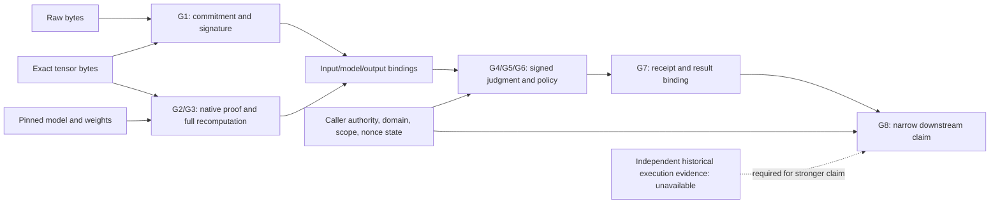

# Typed composition obligations, v2

## Model and status discipline

An evidence item has type
`E=(kind, schema, bytes, subject, representation, domain, authority, scope, policy, dependencies)`.
A guarantee has type
`G=(predicate, subject, scope, authority, evidence, dependencies, assumptions, verification, failure)`.
A caller supplies the intended claim and trust policy separately from the evidence.
Bindings are typed relations: exact bytes, canonical field encoding, digest algorithm,
subject identity, model/version, action, execution id, policy, domain and nonce state.
An untyped digest string is not a proposition about admission or execution.

`VERIFIED` means all obligations for the explicitly named local claim were discharged
under the listed assumptions. `REFUTED` means at least one required obligation has a
concrete contradiction. `UNVERIFIABLE` means at least one required obligation cannot
be established and no required contradiction was observed. We retain the full vector
of obligation statuses, so mixed missing/refuted evidence never disappears.

| Guarantee | Subject and scope | Authority / evidence | Dependencies and assumptions | Procedure / failure classification |
| --- | --- | --- | --- | --- |
| G1 input provenance | exact retained raw and sanitized tensor bytes; declared identity transform | lab attestor role; real EIP-712 artifact, preimages | role key and offline domain are selected by policy; Keccak collision resistance; identity URI is pinned draft convention | recompute raw/input/pipeline commitments and signature; mismatch REFUTED, absent bytes UNVERIFIABLE; external admission remains UNVERIFIABLE |
| G2 model/version | exact public linear operator, weights, encoding and source pin | caller's modelHash; model JSON and weights | no trained-model identity claim; native source and toolchain must match | model digest, weights SHA-256, field, shape, version-by-exact-bytes; mismatch REFUTED, missing model UNVERIFIABLE |
| G3 inference | public 4x8 times 8x8 arithmetic relation and retained proof | pinned native verifier plus independent Python recomputation | trusted compiler/host, native API semantics; no soundness claim for test-style public challenges | deserialize and call verify_shard, bind claims/output, recompute all output; failed check REFUTED, unsupported wire/native error UNVERIFIABLE |
| G4 subject binding | caller's local subject throughout judgment and receipt | caller claim, signed preimages | local names; no external registry or human identity inferred | exact typed subject equality; contradiction REFUTED, missing subject UNVERIFIABLE |
| G5 judgment authenticity | exact LabJudgment signed bytes | authorized policy role key, actual ECDSA | signature scheme and encoder correctness; key custody is a lab assumption | digest/recover/verify; invalid signature REFUTED, absent/unsupported artifact UNVERIFIABLE; judgment soundness is not established |
| G6 judgment authorization | named action, policy, input/model/proof/output and scope | independently selected relying-party policy | trusted policy distribution; no pre-execution timestamp claim | role membership, policy digest, action/scope equality, nonce snapshot; mismatch REFUTED, missing policy UNVERIFIABLE |
| G7 execution receipt binding | exact local receipt subject, execution id, result and observation bytes | lab receipt signer, delivered bytes and local observation | historical observer is not independent; receipt is original lab schema | signature and content/binding checks; mismatch REFUTED; historical external execution UNVERIFIABLE even when signature passes |
| G8 downstream authorization | only `recompute-output` for this public model and policy | independent replay process consuming G1-G7's narrow parts | all required dependencies and bindings checked; no scope escalation | all obligations VERIFIED grants narrow claim; REFUTED dominates UNVERIFIABLE; full external chain NOT IMPLEMENTED |

## Dependency graph

The solid graph is a relation between retained artifacts, not a proof of time order.
Both positive and substitution controls use real signature verification and native
proof verification. Trust in the laboratory policy is explicit. Replay does not
accept arbitrary external file paths as a sandboxed service: this is a CLI research
tool intended to read a caller-selected local fixture.

## Propositions and their status

**PROVEN (definition-level only): refusal under a required contradiction.** Define
aggregation to return REFUTED if any required status is REFUTED; otherwise
UNVERIFIABLE if the set is empty or any required status is UNVERIFIABLE; otherwise
VERIFIED. If a required contradiction exists, the first branch applies, so the
result cannot be VERIFIED. Adding a missing item cannot erase that contradiction.
This elementary argument is not a proof of cryptographic or implementation soundness.

**EMPIRICALLY VERIFIED:** the published fixture produces the declared outcomes
under the executed native verifier, ECDSA checks and composition code. Mutating
named boundaries changes specific witnesses as shown in the mutation report.
Finite tests do not prove completeness against every substitution.

**HYPOTHESIS / candidate conditional preservation proposition:** for a finite
acyclic dependency graph, suppose every native verifier soundly establishes its
typed predicate, all representation translations preserve the consumed predicate,
every cross-artifact equality is checked, authority and policy are authentic and
applicable, and the downstream predicate is entailed by the conjunction of those
predicates and policy rules. Then the downstream claim follows under those
assumptions. A proof would use induction on the graph and rule soundness. Those
premises have not all been established for these upstream prototypes, and no
machine-checked theorem or end-to-end cryptographic security result is asserted.

**HYPOTHESIS / candidate necessity proposition:** removing a nonredundant binding
may permit substitution of a locally valid but unrelated component. Necessity is
profile-dependent: two executed mutants survive because other checks still refuse
their chosen witnesses. This prevents a universal minimality claim.

**NOT IMPLEMENTED:** external admission evidence, observed blockchain domain,
external identity/key history, independent execution-origin evidence, transactional
nonce consumption, conformant upstream judgment/ReceiptOS integration, a full
real-chain positive, and a proof-assistant derivation of preservation.

## Counterexamples

A signature over action A remains a valid signature when offered to authorize B.
A native proof for tensor I remains locally valid when a caller asks about I'.
A receipt for execution E cannot authorize a claim about E'. A correct digest of
retained bytes does not show a remote model admitted those bytes. An authentic local
observation cannot on its own justify a stronger historical external-execution claim.
Executable witnesses, explicit expected tri-state values and individual obligations
are in `src/v2/scenarios.py` and the comparison evidence.
