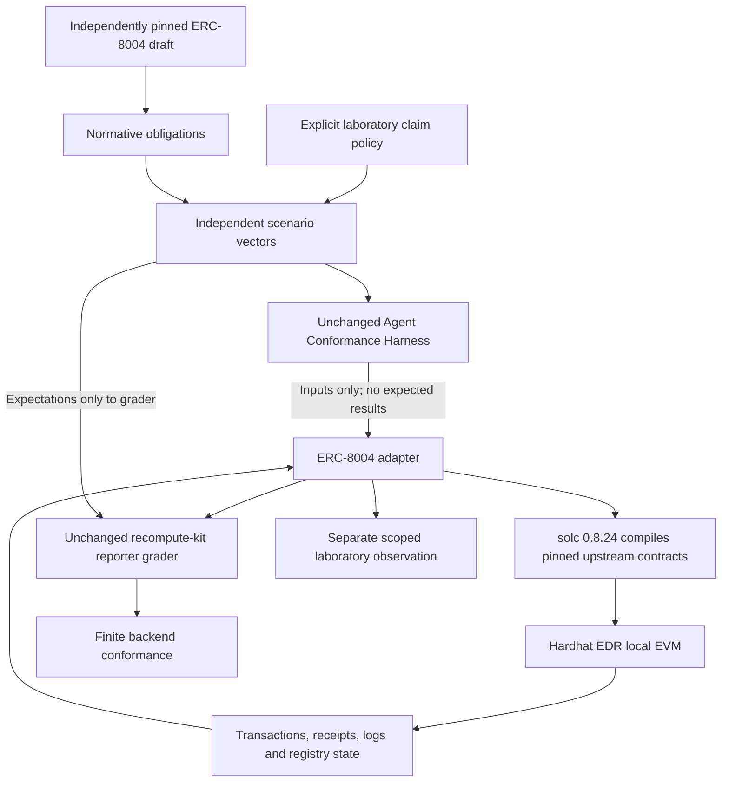

# Second backend: actual ERC-8004 registry execution

No modifications to `tools/agent_harness.py`, its v0 protocol, recompute-kit, Semantic ABI, RSI, existing consumer implementations, frozen ERC-8404 Core or historical evidence are needed. The new code is one profile-specific executable adapter plus its source preparation and test tooling. The grader remains the previously pinned recompute-kit implementation.

The actual target is the upstream `IdentityRegistryUpgradeable` and `ValidationRegistryUpgradeable` runtime. Upstream `HardhatMinimalUUPS` is used only for local owner initialization, followed by a real UUPS upgrade, matching the upstream test setup. It is not a replacement mock of the registries. No public deployment or production upgrade governance is evaluated.

The adapter compiles source rather than importing a previously asserted verification boolean. It deploys the real runtime, sends transactions, reads mined receipts and post-state, and records EIP-712 laboratory signatures. Reverts are identified from receipt status zero; arbitrary exceptions propagate as infrastructure failure. Each scenario begins from a restored independent EVM snapshot.

The portable grading projection excludes implementation-specific transaction hashes and addresses. These remain in the raw execution evidence and full authorization scope. A projected `VERIFIED` result is not a bearer credential and must never be used independently as permission to execute a payment or external task.

Existing ecosystem responsibilities remain separate: Semantic ABI describes semantic relations; RSI supplies invariant/predictor infrastructure; recompute-kit supplies conformance grading. This adapter neither absorbs their code nor claims to replace them.
