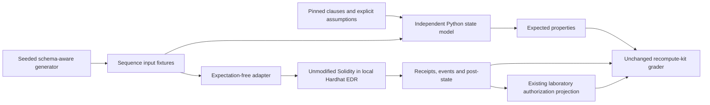

# Bounded generated conformance experiment: design before implementation

Design recorded 2026-10-22, before experimental implementation. Base is exactly
`80c91a09095eca362dbfb69d39d0c01fc31130cf`, whose parent is PR #9
`0e17c97e896916b4d9505072cc9ebe2018329b01`. PR #11 is a sibling supplement,
not part of this experiment. Main and PR #9-#11 remain unchanged.

## Reuse and separation

The existing expectation-free `agent-harness.request.v0` / observation protocol,
`tools/agent_harness.py`, and pinned recompute-kit reporter grader remain unchanged.
Only a new profile supplies sequence inputs, independent expected post-state and
an execution adapter. The existing ERC-8004 laboratory authorization projection is
reused; its narrow transition claim is not a transferable permission.

Expectations never enter adapter stdin. The Python model does not call Solidity,
read observations, or import the authorization implementation. It is nevertheless
an authored oracle, not a formal specification proof. Source review and mutation
witnesses test selected shared-assumption risks. The adapter can access the local
filesystem; expectation-free transport is not a sandbox against a dishonest adapter.

## Architectural sources inspected

- EELS `ethereum/execution-specs@05420bce40492ca7ff11bc79cf3feb24778dce83`:
  `packages/testing/src/execution_testing/specs/state.py`, `fixtures/state.py`,
  `fixtures/consume.py` separate authored state expectations, portable fixtures and
  consumers. Reuse that separation, not its framework or consensus fixture schema.
- [Foundry invariant testing](https://getfoundry.sh/forge/invariant-testing):
  bounded actor handlers, state tracked separately from contracts, checks after
  each call and replayable sequences inform this design. Retrieved page is hashed
  in the source audit. This experiment does not execute Forge.
- Echidna `crytic/echidna@286449a545e0e2b84feba95a3d7602af66be306b`:
  ABI-shaped sequences, fixed budgets and replay-based shrinking; inspected
  `lib/Echidna/Shrink.hs`, `tests/solidity/basic/default.yaml` and `flags.sol`.
  No Echidna code is imported and no Echidna campaign is claimed.

## Bounded implementation decision

Use the already pinned Hardhat 3.0.6 / ethers 6.15.0 / solc 0.8.24 runtime.
Three fixed seeds, 100 sequences per seed, short structured families plus varied
actors, values and ordering. Snapshot isolation preserves empty initial state per
sequence. Every transaction, including expected reverts, is observed. Check model
state after every call. Small batches preserve the unchanged transport timeout.

Reuse the existing source-pinned EVM bootstrap and receipt capture by assembling
them with the new sequence executor in ignored build output. Do not fork a generic
verification engine. New physical test-only source variants target boundaries
absent from the original deterministic suite. Run that same original suite against
each variant before claiming additional mutation sensitivity.

Preserve original and minimized mutant witnesses. Deletion minimization must rerun
the real EVM and retain the same divergence category. Test-only counterexamples
are not defects in the original implementation. Source bytes are restored and
hashed before accepting a kill.

Second independently authored same-profile implementations, second EVM backends,
branch coverage, real-network execution and additional ERC adapters are NOT_COVERED.
The fixture format leaves backend selection external for later independent replay.
