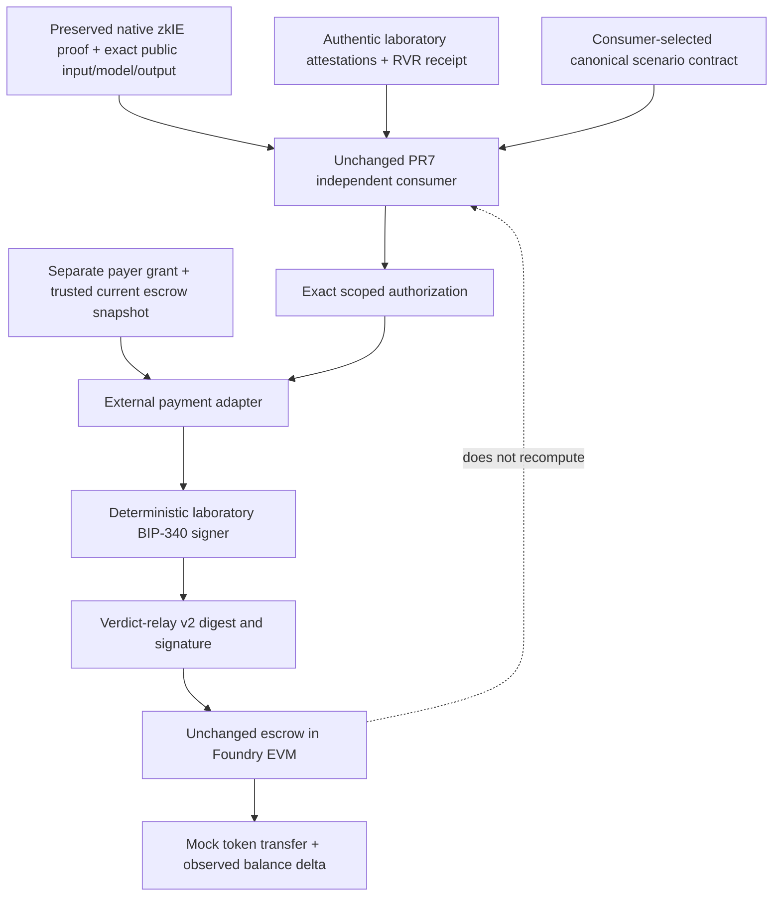

# Claim-aware result to verdict-gated escrow: laboratory architecture

The public Base deployment is inspected only through read-only RPC. Local test
instances are ephemeral in-process EVM objects; no Anvil RPC deployment, network
broadcast, real funds or production key is used. The production fixed verifier key
is different from the deterministic public laboratory key.

The deployed escrow does not call the adapter. Anyone holding an approving signature
can submit it directly. An honest signer/gateway is therefore a necessary off-chain
assumption. An expiry or revocation that changes after signing is not independently
enforced by the existing contract. A stronger mandatory on-chain policy requires a
new interface/contract or separately authorized gate; none is implemented upstream.

The adapter grants only payment for the verified laboratory replay/review service
under a separately supplied payer policy. Native inference verification does not
itself authorize spending. No assertion of completed external work is introduced.
