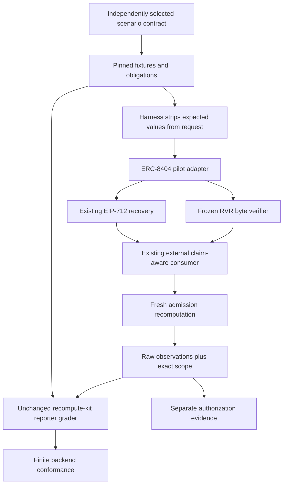

# Architecture and source audit

Base: `2e329fffbee103047d034b97056aea9e49cf1c58`. Live audit captured main, PR1-8 merge states/ancestry and exact-main CI under [audit evidence](../../evidence/harness-v0/audit/summary.json). All eight PR heads are ancestors. This pilot starts from main, separately from the unmerged documentation branch.

## Reuse decisions from implementation code

| Component / exact revision | Code inspected | Existing capability and decision |
| --- | --- | --- |
| Semantic ABI `d15c666dfccff17f7350fe97d2fc7b71cb2cbaee` | `runner/src/evaluate.mjs`, `linker.mjs`, `adapters.mjs` | Already separates relation preservation from backend conformance and links typed claim/scope boundaries. Do not recreate its linker. The inspected demo adapters read the oracle; they are not selected as real implementations. This is not a claim that all its adapters are mocks. |
| RSI `3d3038f90c3dd98e79f948398167c5cc3ef2fdd8` | `runner/execution.py`, `expectation_contract.py`, `adapter_registry.py`, `expectation_registry.py` | Already has explicit registries, detached requests and independently admitted expectation profiles. Do not create a second RSI relation executor or represent this pilot as implementing RSI. A future mapping needs an independently specified predictor/expectation contract. |
| recompute-kit `f7308cdd5ba55ac8229103e82ebc5fc14f81b88b` | `tools/run_conformance.py`, `bin/conformance-suite` | Already executes reporters, compares canonical results and rejects missing/extra/crashed output. Reuse the exact reporter grader and its canonical comparison. Add only transport separation, requirement labels and evidence envelope. |
| agent-ercs `01283ca57305f915afb560d23359a27fd748eb5a` | ERC8274 `IProofVerifier.sol`, `IAgentVerifier.sol`; ERC8299 `IWyriweAttestation.sol`; `conformance/attester-diversity-v0/gate.ts` | Inspected verification/attestation Solidity files are interfaces. The diversity gate consumes modeled signature-validity/controller facts. Neither establishes a real cryptographic implementation pilot. A concrete ConsultEscrow contract exists but would tie the first pilot to escrow. No universal implementation-availability claim. |
| VECA base above | `src/composition.py`, `research/formal-v1/model.py`, `src/v3/evidence.py`, `src/v4/model.py`, `src/v4_1/model.py`, `src/erc8404/engine.py`, `src/integration/engine.py`, `experiments/verdict_escrow/adapter.py` | Existing synthetic/typed/crypto/coverage/admission engines and escrow experiment stay intact. Reuse `src/erc8404/engine.py` directly; do not copy its semantic checks into a new engine. |
| Frozen RVR executable `9dd36e882dd372f264b77b179130948aa5adcbde` | Python `conformance/rvr-v0/adapter.py`, specification, schema/profile package | Real off-chain byte verifier with executable conformance suite. Existing vendored 13-file Core remains byte-identical. No deployment or on-chain verifier is implied. |

[Source lock](../../conformance/agent-harness-v0/source-lock.json) records repositories, commits and audited-file byte hashes. The Core draft remains pinned at `pipavlo82/ERCs@7a9e63a80bce04db53c6550103c1d41eca35f3d1`, `ERCS/erc-8404.md`. These historical pins are not assertions about current draft text.

## Smallest added capability

The gap addressed here is a reusable adapter transport and conformance report over existing verification, with separately declared normative/policy obligations and expectation-free inputs. It is not a new cryptographic verifier, formal model or generic composition engine.

The target implementation owns evidence verification; the adapter performs lossless projection of its outputs. The harness owns transport/inventory/protocol checks; recompute-kit owns expected-value comparison. The policy owner supplies adequate obligations and expected outcomes. The reviewer must independently check that these correspond to the intended claim and actual native behavior.

Licenses, original authorship and all research history are preserved. The runtime fetch retains recompute-kit's existing LICENSE. No governance or maintainer agreement is asserted. No scientific novelty or upstream vulnerability is claimed.
